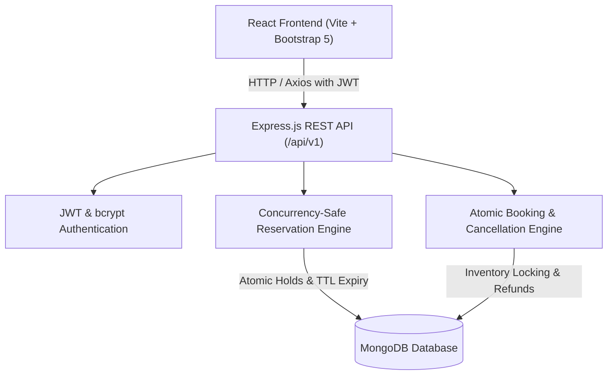

# 🎬 IMovies — Movie Ticket Booking Made Simple

A full-stack, production-style cinema ticket booking platform built with the **MERN stack** (MongoDB, Express.js, React, Node.js), Vite, and Bootstrap 5. Features concurrency-safe seat reservation holds, real-time seat status maps, digital e-tickets with QR codes, demo checkout, ticket cancellations, and a central administration portal.

---

## 🌟 Key Features

### 🍿 Customer Movie Discovery & Booking
- **Cinematic Discovery Hero**: Dynamic billboard premiere banner with trailer modal preview and direct booking CTA.
- **Search & Filtering**: Live title/cast search, genre filtering pills, language filter, and sorting (IMDb Rating, Newest Release, Alphabetical) synced with URL query parameters.
- **Movie Details**: Full synopses, certificate ratings, duration, director, starring cast, and integrated showtime selector.
- **Multi-Cinema & Screen Listings**: Real-world cinema networks (Laser IMAX, Dolby Atmos, 4DX) across major cities (Mumbai, Bengaluru, Delhi NCR).
- **Interactive Cinema Seat Map**:
  - Curved glowing screen indicator (*Screen This Way*).
  - Multi-tier seat categories: **Standard Classic**, **Premium Prime**, and **VIP Recliner Lounges**.
  - Dynamic visual states: `Available`, `Selected`, `Temporarily Held by Another Customer`, and `Sold Out`.
  - Max seat limit enforcement (up to 10 seats per booking).
- **Concurrency-Safe Seat Reservation**:
  - Server-side atomic seat locking prevents double bookings.
  - 8-minute countdown hold timer with automatic status refresh upon expiration.
- **Itemized Pricing & Promo Code**: Live calculation of base ticket price, convenience fees, and 18% GST with optional promo code (`IMOVIES20`).
- **Simulated Checkout & Gateways**:
  - Instant 1-click test checkout mode for fast demonstration.
  - Sandbox modes for Credit/Debit Cards, UPI / QR, and Net Banking.
  - Confetti celebration animation upon ticket confirmation.
- **Digital E-Tickets**: Perforated ticket stub design with unique reference (`IMV-XXXXXX`), turnstile QR code, screen details, and Print/Save PDF support.
- **Ticket Wallet & Cancellations**: Filter bookings by status (`Confirmed` / `Cancelled`), view past tickets, and cancel eligible bookings (up to 2 hours before showtime) with calculated refunds and immediate seat inventory release.

### 🛡️ Administrative Portal
- **KPI Metrics Dashboard**: Live aggregate statistics for Net Revenue, Confirmed Tickets, Now Showing titles, and Registered Customers.
- **Movie Catalogue Management**: Modal form for adding, editing, and deleting movie records with poster/backdrop URLs and YouTube trailer embeds.
- **Multiplex & Screen Configuration**: Add cinema venues and screens with customizable auditorium seating formats.
- **Showtime Scheduler**: Collision detection engine preventing overlapping schedules on the same screen.
- **Global Booking Audit Log**: Search platform-wide bookings by reference code with manual cancellation override.
- **User Role Management**: Inspect customer accounts and toggle administrative privileges safely.

---

## 🏗️ System Architecture



---

## 🛠️ Technology Stack

| Layer | Technologies |
|---|---|
| **Frontend** | React 18, Vite 6, Bootstrap 5, Lucide React, React Router 7, Axios, Canvas Confetti |
| **Backend** | Node.js 24+, Express.js 4, Mongoose 8, JWT, bcryptjs, Helmet, CORS, Morgan |
| **Database** | MongoDB (Production) with zero-setup In-Memory MongoDB fallback |
| **Testing** | Vitest, React Testing Library, Jest, Supertest |

---

## 📁 Project Structure

```
movie/
├── package.json               # Root scripts orchestrator
├── README.md                  # Comprehensive documentation
├── .gitignore                 # Standard Git ignore rules
│
├── server/                    # Node.js + Express Backend
│   ├── package.json
│   ├── .env.example
│   ├── .env
│   ├── src/
│   │   ├── config/db.js       # Smart DB connection (Atlas / Local / Memory fallback)
│   │   ├── models/            # User, Movie, Cinema, Screen, Showtime, Booking, SeatReservation
│   │   ├── controllers/       # Auth, Movie, Cinema, Showtime, Reservation, Booking, Admin
│   │   ├── routes/            # REST API endpoints under /api/v1
│   │   ├── middleware/        # JWT verify, requireAdmin, errorHandler, rateLimiter, validate
│   │   ├── services/          # reservationService, bookingService
│   │   ├── utils/seedData.js  # Rich demonstration seed script
│   │   ├── app.js             # Express app setup
│   │   └── server.js          # Server entry point
│   └── tests/                 # Jest & Supertest API & concurrency tests
│
└── client/                    # React + Vite Frontend
    ├── package.json
    ├── vite.config.js
    ├── index.html
    ├── src/
    │   ├── components/        # Navbar, Footer, MovieCard, MovieGrid, MovieHero, SeatMap, TicketCard...
    │   ├── context/           # AuthContext, BookingContext, ToastContext
    │   ├── pages/             # Home, NowShowing, Upcoming, MovieDetails, SeatSelection, Checkout...
    │   ├── services/api.js    # Axios client with interceptors
    │   ├── styles/index.css   # Modern dark cinematic theme & glassmorphic styles
    │   ├── App.jsx            # Router and layout configuration
    │   └── main.jsx
    └── tests/                 # Vitest & React Testing Library component tests
```

---

## ⚡ Quick Start & Run Commands

### 1. Install Dependencies
```bash
# From the project root
npm run install:all
```

### 2. Seed Initial Demonstration Data
```bash
npm run seed
```
*Seeds 7 premiere movies, 3 cinema multiplexes, 6 auditorium screens with 76 tiered seats each, 120 future showtimes, and default demo accounts.*

### 3. Start Development Servers
```bash
npm run dev
```
- **Frontend**: [http://localhost:5173](http://localhost:5173)
- **Backend API**: [http://localhost:5000/api/v1](http://localhost:5000/api/v1)
- **Health Check**: [http://localhost:5000/api/v1/health](http://localhost:5000/api/v1/health)

---

## 🔑 Demonstration Accounts

The platform includes convenient 1-click **"Fill Demo User"** and **"Fill Demo Admin"** buttons on the Login page:

| Role | Email | Password |
|---|---|---|
| **Administrator** | `admin@imovies.com` | `Admin@12345` |
| **Demo Customer** | `user@imovies.com` | `User@12345` |

---

## 🧪 Automated Testing

Both the backend and frontend have comprehensive test suites verifying critical functionality:

### Run Backend Tests (Jest & Supertest)
```bash
npm run test:server
```
**Tests Covered (12/12 Passing)**:
- User registration and email uniqueness enforcement.
- Credential validation and JWT session issuance.
- Profile retrieval and unauthorized rejection.
- Concurrency-safe seat reservation holds.
- **Seat Conflict Prevention**: Two users attempting to hold the same seat receives `409 Conflict`.
- Atomic booking confirmation and inventory locking.
- Booking cancellation and automatic seat release back to inventory.

### Run Frontend Tests (Vitest & RTL)
```bash
npm run test:client
```
**Tests Covered (5/5 Passing)**:
- `MovieCard`: Title, rating, certification, and duration formatting.
- `SeatMap`: Curved screen layout, tier rendering, selection callbacks, and disabled states for booked/held seats.
- `TicketCard`: Reference code, movie details, seats, price breakdown, and total.

---

## 🚀 Deployment Guide

### Frontend (Vercel / Netlify)
1. Set the root directory to `client`.
2. Build command: `npm run build`.
3. Output directory: `dist`.
4. Configure environment variable: `VITE_API_BASE_URL=https://your-backend.onrender.com/api/v1`.

### Backend (Render / Railway / AWS EC2)
1. Set root directory to `server`.
2. Build command: `npm install`.
3. Start command: `npm start`.
4. Configure environment variables:
   ```env
   NODE_ENV=production
   PORT=5000
   CLIENT_URL=https://your-frontend.vercel.app
   MONGODB_URI=mongodb+srv://<user>:<password>@cluster.mongodb.net/imovies?retryWrites=true&w=majority
   JWT_SECRET=your_super_strong_production_secret_key_123456
   HOLD_EXPIRY_MINUTES=8
   ```

---

## 📄 License
MIT © IMovies Team. Designed for high-reliability cinema ticket booking.
